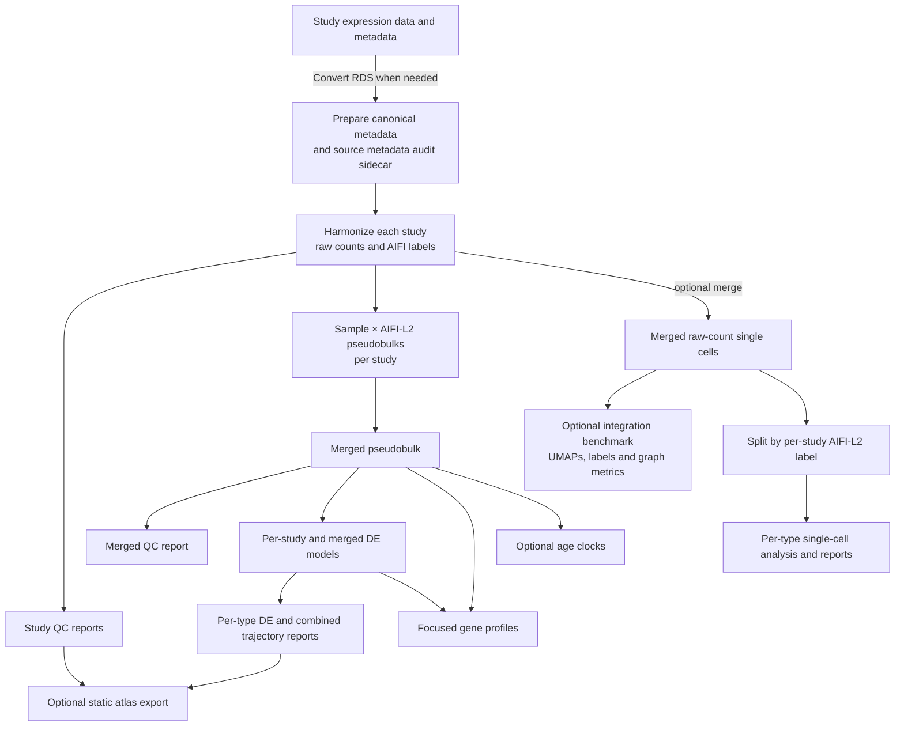

# Harmonization and annotation

[Documentation](../README.md)

Configuration-driven processing of PBMC ageing scRNA-seq studies. It produces
one harmonized H5AD per study, per-study sample × AIFI-L2 pseudobulks, and a
cross-study pseudobulk matrix. The standard Make workflow also creates a
raw-count cross-study single-cell merge, which can be disabled when not needed.
A separate, opt-in integration benchmark compares unintegrated PCA, Harmony,
and BBKNN representations and their method-specific cell graphs, then publishes
labels and UMAPs.

Study-specific inputs and adapter dependencies live in `config/studies.json`;
the tracked `config/studies.schema.json` and
`config/input_sources.schema.json` enforce their document structures before a
workflow starts. Explicit adapters under `src/pbmc_pipeline/studies/` own
source-specific joins and reshaping. The output metadata contract lives in
`config/harmonized_obs_schema.json`. See the [architecture reference](../reference/architecture.md)
for the component boundaries.

See the [input catalog](../inputs/files.md) for the complete list of external expression files,
supplementary metadata, CellTypist models, expected paths, and checksums.

## Data flow

The core workflow publishes harmonized data and QC under
`output/harmonization/`. Downstream analyses are published under
`output/analysis/`, including `per_type/`, `combined/`, and `per_gene/`.
The single-cell merge, integration benchmark, age clocks, and downstream
analyses can also be run separately; see the target table below.

All immutable local inputs belong under `input_data/`. Generated conversions,
reports, and harmonized outputs are kept outside it and ignored by Git.
Pipeline-wide GO enrichment inputs in `input_data/go/` and study-specific
inputs remain under `input_data/`.

Per-cell preparation artifacts are generated under
`<outdir>/harmonization/prepared/`; they are reproducible from the expression
object plus the declared study dependencies.
Each study also publishes `<study>.source_obs.csv.gz`, the retained source
observation metadata keyed by `cell_id`. This sidecar is an audit trail for
adapter mappings; the harmonized H5AD continues to expose only the canonical
metadata schema.

### Annotation semantics

`aifi_l2_majority` is the retained per-study AIFI-L2 annotation and the sole
canonical label for pseudobulk grouping, cell-type splitting, and composition
denominators. The optional integration benchmark produces diagnostic
`benchmark_*_aifi_l2_majority` labels; those must not replace per-study L2 in
any downstream analysis.
