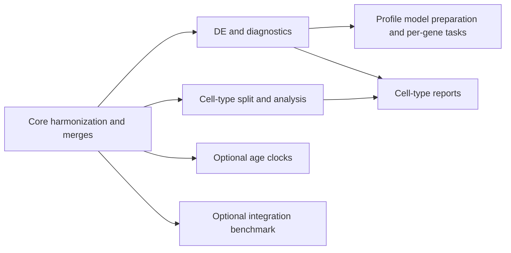

# Workflow orchestration

[Documentation](../README.md)

Make owns developer commands, environment setup, Docker builds, checks, and
frontend tools. Nextflow owns scientific dependencies, per-type and per-gene
tasks, task caching, and publication. Python modules own the calculations.

## Entry points

`make run` runs the core harmonization and merges. `make run-all` invokes
`pipeline.nf`, which composes the named workflows under `workflows/`:



Production `run-all` retains its default stages: core, DE, top-gene profiles,
and cell-type reports. Enable the optional branches explicitly:

```bash
make run-all RUN_CLOCKS=true RUN_BENCHMARK=true
```

The standalone `.nf` entry scripts use these same named workflows. They accept
existing inputs for focused work; targeted report commands never acquire an
implicit prerequisite on the core workflow. Production runs are resumable;
test aliases run fresh. Production/test Make targets share recipes and derive
input and output paths from `OUTDIR`, unless an input path is explicitly supplied.

## Dependencies and caching

Composed stages consume producer output channels. Gene ranking uses the current
run's DE results, and cell-type reports receive the current run's matching DE
files. Published output directories are not used to discover intermediate inputs
inside the composed graph. Standalone commands intentionally accept existing
published artifacts.

Gene profiles prepare one immutable PyDESeq2 model per cell type, then calculate
and render individual genes in separate tasks. A prepared model must match the
configuration, counts, samples, genes, design, and software version; a mismatch
fails the gene task rather than silently refitting. Per-type profile context is
collected independently of cross-type DE reporting, so an aggregation failure
does not prevent successful types from producing gene profiles.

Clock fitting runs per cell type, followed by independent method/comparison
reporting and a cross-type aggregation of this run's successful fits. Eligible
skips remain explicit records. Clock publication is confined to `ageing_clock/`;
it must not replace a whole cell-type directory shared with other analyses.

Moving a process into a named workflow changes its task name and can invalidate
old cache entries. The public focused entry points remain available, but the
first run after this orchestration migration may recompute tasks. Keep Nextflow's
cache and work directories for subsequent resumes. `make workflow-test-resume`
checks that two genes share one preparation task, identical runs reuse all tasks,
and changing only the report template reruns rendering alone.

## Failure isolation

Independent analysis and report task failures do not stop sibling tasks or
unrelated branches. Successful outputs remain published, including completed cell-type analysis
files when their report fails. Dependent tasks that
lack an upstream result cannot run; aggregators use completed streams and
explicit expected inputs to describe partial results, including the case where
all cell-type analyses fail. Eligibility skips are distinct from unexpected
clock failures. Essential input/configuration errors and core processing failures
remain fatal.

Every Make workflow invocation goes through `scripts/run_workflow.py`. It writes:

- `<outdir>/provenance/workflows/<target>-<run-id>/trace.tsv`: task status and exit codes.
- The adjacent `nextflow.log` and `summary.json`: `complete`, `partial`, or `failed`, with failed tasks
  and declared application-level partial summaries.
- `<outdir>/workflow_summary.json`: an atomic copy of the latest invocation summary.

An analysis run with ignored task failures exits successfully and records
`partial`. Verification checks require `complete` and fail after the workflow
has finished; old published artifacts cannot make a partial current run pass.
`make workflow-test-failures` injects fitting failures, rendering failures, and
an all-failed cell-type branch into the production process definitions. It
asserts continued sibling work, retained scientific artifacts, and partial
summaries. CI runs this check without scientific inputs or Docker.

## Integration tests and finalization

`make run-all-test` exercises the composed graph with a fresh core run, then
checks its scientific artifacts. It creates the synthetic pseudobulk once and
shares it across DE, clocks, top-gene profiles, and an additional planted-gene
profile. The benchmark and three cell-type reports use the real test merge.

`make run-analysis-test` runs that same downstream graph against existing test
merges. Use it while changing orchestration without rebuilding the core.
`VERIFY_CELL_TYPES` selects its cell types; the verification clock defaults to
`elastic_net` with the small configured search grid.

The shared runner refreshes the workspace report index once after Nextflow
finishes, including partial and failed runs. This is deliberately an uncached
workspace inventory, so it can also show existing published reports. Use
`make render-report-index` to refresh it manually. Frontend release export and
builds remain separate explicit operations.
